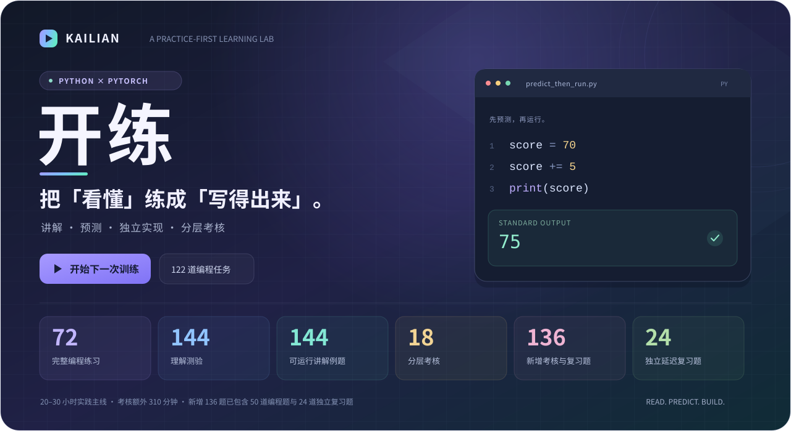
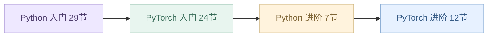
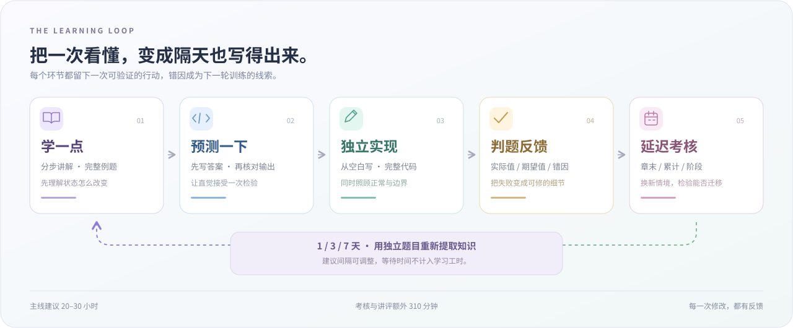
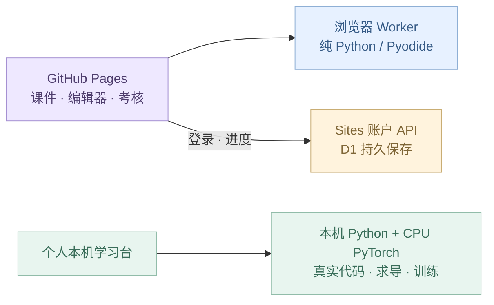

<a href="https://hellojim2007.github.io/kailian/">
  
</a>

<p align="center">
  <a href="https://hellojim2007.github.io/kailian/"><strong>▶ 在线体验</strong></a>
  &nbsp; · &nbsp;
  <a href="https://github.com/hellojim2007/kailian"><strong>☆ 收藏 / Star</strong></a>
  &nbsp; · &nbsp;
  <a href="#先试两道"><strong>先试两道</strong></a>
  &nbsp; · &nbsp;
  <a href="#选择你的路线"><strong>学习路线</strong></a>
  &nbsp; · &nbsp;
  <a href="https://github.com/hellojim2007/kailian/actions/workflows/pages.yml">部署状态 ↗</a>
</p>

# 开练 · 让代码能力有练习，也有回声

面向“看得懂代码，却还不能独立写出来”的学习者。当前开放 **Python × PyTorch**：从完整例题开始，先预测结果，再从空白写代码，用边界测试和延迟考核检查自己能否迁移。

新版推荐路线为 **53 节入门主线＋19 节进阶回访**。入门主线建议 **20–30 小时**；进阶内容另计，按需要回访。全量分层考核额外 **310 分钟，约 5 小时 10 分钟**，讲评与个人重试可延长。这是实践入门路线，后续仍需通过项目持续积累。

> 正式入口指向 GitHub Pages，发布结果见上方部署状态。网页 Python 在浏览器中执行；真实 PyTorch 代码目前使用本机版。账户后端负责登录与进度同步，**不执行学生代码**。

## 练习量，算清楚

| 实践主线 | 分层验收 | 反复提取 |
| :--- | :--- | :--- |
| **12 个主题 · 72 道完整编程练习** | **18 份考核 · 136 道新增题** | **24 道独立复习题** |
| 144 道理解题 · 144 个可运行例题 | 12 份章末 + 4 份累计 + 2 份阶段 | 建议在 1 / 3 / 7 天后回访 |
| 基础 → 进阶 → 排错 → 综合 | 50 道新增编程题已包含在 136 题内 | 已包含在 136 题内，不重复累计 |

**合计 122 道正式编程任务 = 72 道课程练习 + 50 道考核编程题。** 另外每节增加一道短程序热身，共 **72 道热身**；以实际输出即时反馈，不冒充完整边界验收或独立掌握证据。原有练习全部保留。

## 这次把“学一点”重新写了一遍

全部 72 节都有语法/API 用法卡片、参数与返回值说明、可运行最小例子、独立热身编辑器和逐步任务拆解。共 **63 个不同的 API 示例**，在相应课节首次讲解，后续可展开复习；原 144 个完整例题继续保留。文本处理先讲 `lower()`、`split()`、`strip()` 各自做什么，再跟踪值与类型，最后组合成函数。

默认“继续推荐路线”按具体先修关系前进：先函数再切片/文本函数，先求导→SGD→直线拟合，再组织模型与训练；稳定损失、递归与注意力留到进阶。左侧 12 个主题和旧题号保留，便于查找和兼容历史进度，**不是首次学习的推荐顺序**。



简单赋值、索引、循环计数改用代码例子与热身；保留 **5 个可选的张量/梯度/训练实验**。热身与正式作业分开保存，查看热身参考也单独记录。[完整整改说明、教材依据与72节映射](CURRICULUM_REDESIGN.md)



## 选择你的路线

<p align="center">
  <a href="#python-route">🟣 Python 基础</a>
  &nbsp; → &nbsp;
  <a href="#pytorch-route">🟢 PyTorch 实验</a>
  &nbsp; → &nbsp;
  <a href="#assessment-route">🟠 分层考核</a>
</p>

<a id="python-route"></a>

### Python · 先把程序写完整

| 章节 | 训练内容 | 最后要能做什么 |
| :--- | :--- | :--- |
| 01 · 起步与控制流 | 输入转换、分支、循环、边界 | 独立写完整输入输出程序 |
| 02 · 序列与字符串 | 切片、副本、分词、窗口、去重、padding | 处理一批真实数据并保留正确顺序 |
| 03 · 函数与组合 | 返回值、参数、生成器、默认值、异常 | 写出别人可以继续调用的函数 |
| 04 · 字典与实验数据 | 计数、分组、排序、配置、有效指标 | 整理实验记录，得到可重复的结果 |
| 05 · 文件、异常与测试 | JSON / CSV / JSONL、结构验证、报告 | 读取实际文件并写出可重跑的脚本 |
| 06 · 类与数据流水线 | 状态、评估器、数据集、组合、组隔离 | 搭建有清晰接口的数据组件 |

<a id="pytorch-route"></a>

### PyTorch · 把实验真正跑起来

| 章节 | 训练内容 | 最后要能做什么 |
| :--- | :--- | :--- |
| 07 · 张量形状与索引 | batch、展平、mask、索引、距离 | 根据含义管理每个维度 |
| 08 · 广播与数值稳定 | softmax、logsumexp、损失、多头注意力 | 识别能运行却算错的张量代码 |
| 09 · 梯度与训练排错 | 计算图、累积、数值求导、裁剪 | 找到参数为什么没有正确更新 |
| 10 · 模型与数据加载 | Module、参数注册、Dataset、collate | 把数据送进真实可训练模型 |
| 11 · 训练、评估与恢复 | 训练步骤、指标聚合、模式、checkpoint | 正确训练、评估并恢复实验 |
| 12 · 综合实验与挑战 | 拟合、分类、指标、池化、因果边界 | 完成一个可验证的小型实验 |

<a id="assessment-route"></a>

### 分层考核 · 换一个情境，还能写出来吗

| 层次 | 数量 × 建议用时 | 检查什么 |
| :--- | :--- | :--- |
| 章末卷 | 12 × 10 分钟 | 本章的输出理解、排错和独立实现 |
| 累计卷 | 4 × 25 分钟 | 交错调用前面学过的知识 |
| 阶段卷 | 2 × 45 分钟 | 完成综合数据、训练或评估任务 |
| 独立复习 | 每章 2 题，共 24 题 | 隔一段时间后重新提取知识 |

考核题在交卷后统一讲评，代码任务包含正常、边界或异常验收。18 份试卷按完整知识主题考察，包含进阶回访内容；请看各卷已完成练习提示，不把主题编号当成推荐路线步骤编号。计时是训练节奏参考，1 / 3 / 7 天是建议间隔，等待时间不计学习工时。

## 先试两道

GitHub README 支持点击展开答案；完整编辑器、实际运行与判题请进入学习台。

### ① 这次输出究竟是多少？

```python
score = 70
score += 5
print(score)
```

<details>
<summary><strong>我想好了，展开标准输出与解释</strong></summary>

```text
75
```

`+= 5` 把旧值 70 加 5 后重新保存。本例代码与标准输出对应，初值是 70。

</details>

### ② 每一行，减去谁的均值？

```python
import torch

x = torch.tensor([[2., 4.], [10., 14.]])
print((x - x.mean(dim=1, keepdim=True)).tolist())
```

<details>
<summary><strong>先追踪 shape，再展开答案</strong></summary>

```text
[[-1.0, 1.0], [-2.0, 2.0]]
```

行均值分别为 3 和 12。`keepdim=True` 保留 `[2, 1]` 形状，使每行减去自己的均值；误写成 `[2]` 可能按列广播，方阵上甚至不会报错。

</details>

<p><a href="https://hellojim2007.github.io/kailian/"><strong>带着这个问题，去学习台试一试 →</strong></a></p>

## 练习时，你会拿到什么

- **完整的示例与明确契约。** 先看代码和实际输出，任务写明返回值、形状、类型及关键边界。
- **按难点保留的 5 个可选实验。** 动手观察维度、梯度和训练；简单操作用代码例子与热身验证。
- **从空白开始的编辑器。** 写完整程序、函数或实验组件；标准输入和练习附件由运行环境提供。
- **能定位问题的反馈。** 对照实际值与期望值，查看失败验收；主线提示逐步展开，参考实现不会自动通关。
- **可回访的学习记录。** 地图支持搜索、难度与状态筛选；代码草稿、理解题和考核尝试随学习保留。
- **需要时再登录。** 访客直接学习；导入导出 JSON 便于迁移、备份和继续练习。

<!-- Maintainer: insert verified real application screenshots here; do not substitute mockups. -->

## 进度跟着账号走，也留在当前设备

登录同步以正式 Pages 入口与可用的账户服务为前提。账户空间按**用户 + 课程**隔离；另一台设备登录同一账号后，可以读取该课程的云端历史。当前设备仍保留本机副本，网络失败时可继续写并导出备份。

访客进度不会因为点击登录就自动上传。已有访客内容需要手动导入到账号；切换账号也不会把上一位学习者的草稿当作新账号内容。

**从本机版迁移：** 先在本机版导出进度 JSON，再到正式网页入口登录账号，手动导入这份文件。本机版不会自动把历史上传到网页账号。

<details>
<summary><strong>两台设备都改过进度，会发生什么？</strong></summary>

云端保存带版本号，写入采用 CAS（比较当前版本后再保存）。遇到旧版本提交，服务端返回冲突而不是覆盖更新历史；客户端保留本机与云端快照，让学习者选择继续使用哪一份。它不会静默合并两个版本，也不会假定超时就代表写入失败。

本机草稿、账号历史、进度备份与登录凭据分别处理；凭据不会放进课程进度导出文件。账户 API 与限制见 [cloud/README.md](cloud/README.md)。

</details>

## 网页版与本机版，能力分别在哪里

| 能力 | GitHub Pages 网页版 | 个人本机版 |
| :--- | :--- | :--- |
| 讲解、例题、预测题、课程地图、考核界面 | ✓ | ✓ |
| 纯 Python 实际执行与判题 | 浏览器 Pyodide Worker | 本机 Python |
| 原生 PyTorch 代码、自动求导与训练 | 当前不提供网页计算 | 真实 CPU PyTorch |
| 登录与跨设备进度 | 独立 Sites 账户 / D1 服务 | 本机历史用 JSON 导入网页账号 |
| 多学科 | 当前仅 Python × PyTorch | 课程扩展约定见下方 |



GitHub Pages 托管静态前端，Sites 后端处理账户与 D1 进度存储；后端的 `/api/run` 不提供学生代码云执行。原生 PyTorch 当前仍在个人电脑中运行。未来若接入多人在线执行，需另建隔离执行服务，不能直接公开现有本机 API。[部署边界与后续方案](DEPLOYMENT.md)

## 本机开始

前端无需安装依赖或打包。真实 PyTorch 运行需要 Python 3.10+、NumPy 和与系统匹配的 PyTorch；以下 CPU 安装命令面向 Windows / Linux，其他平台可按 [PyTorch 官方安装向导](https://pytorch.org/get-started/locally/) 选择。

```sh
git clone https://github.com/hellojim2007/kailian.git
cd kailian

python -m venv .venv
```

<details>
<summary><strong>激活环境：选择你的系统</strong></summary>

Windows PowerShell：

```powershell
.\.venv\Scripts\Activate.ps1
```

macOS / Linux：

```sh
source .venv/bin/activate
```

</details>

```sh
python -m pip install numpy
python -m pip install torch --index-url https://download.pytorch.org/whl/cpu
python server.py
```

打开 [http://127.0.0.1:8766](http://127.0.0.1:8766)。Windows 也可在环境就绪后运行根目录的 `启动学习台.ps1`。

本机服务仅监听回环地址，适合执行自己编写的练习代码；子进程与超时不构成安全沙箱，不应把它直接暴露为公开多人执行服务。

## 开发与验证

使用 Node.js 24+ 和上述 Python / CPU PyTorch 环境。课程源文件在 `curriculum/`，浏览器文件在 `dist/`，账户服务在 `cloud/`。

<details>
<summary><strong>重新生成课程与考核</strong></summary>

```sh
python -X utf8 curriculum/build.py
python -X utf8 curriculum/build_assessments.py
```

课程与考核分别生成，原练习 ID、代码草稿及通关兼容规则保留。

</details>

<details>
<summary><strong>验证内容、代码语义和学习记录</strong></summary>

```sh
npm run check

python -X utf8 verify.py
python -X utf8 verify_content.py
python -X utf8 verify_guides.py
python -X utf8 verify_python_semantics.py
python -X utf8 verify_torch_semantics.py
python -X utf8 verify_assessments.py
python -X utf8 verify_api.py

node verify_progress.mjs
node verify_assessment_state.mjs
node verify_progress_sync_state.mjs
node verify_lab_alignment.mjs
node verify_learning.mjs
node verify_python_labs.mjs
node verify_torch_labs.mjs
node --test cloud/pages-auth.test.mjs cloud/verify.mjs
```

`verify_api.py` 需要先在另一终端启动 `python server.py`。这些检查分别覆盖参考实现、例题输出、独立语义对照、考核判题、API 契约、旧进度迁移与账号同步状态。内容可靠性还依赖持续复核；发现题目问题时，欢迎附题号、输入及实际结果提交 [Issue](https://github.com/hellojim2007/kailian/issues)。[内容复核记录](CONTENT_AUDIT.md)

最新教学重构见 [课程整改说明](CURRICULUM_REDESIGN.md)。此前语义复查记录：[Python 36 节](PYTHON_LESSON_REVIEW.md) · [PyTorch 36 节](TORCH_LESSON_REVIEW.md) · [交互对应关系](CONTENT_INTERACTION_AUDIT.md)。未知题目 ID 不会回退到通用动画。

</details>

<details>
<summary><strong>准备静态 Pages 与账户 Worker 产物</strong></summary>

```sh
npm run build:pages

# 配置自己的 Sites 部署后，再构建账户 Worker：
npm run build:cloud
```

`build:pages` 只把公开浏览器文件复制到 `.runtime/pages/`；GitHub Actions 的 Pages 工作流发布这个目录。`build:cloud` 将当前静态资产打包为 Sites Worker 产物，不等于部署，也不会创建远程数据库。前端有改动后需重新构建对应产物。

公共 GitHub 仓库不包含现有 Site 的 `.openai/hosting.json`。自行部署账户服务时，先参考 `cloud/hosting.example.json` 为自己的 Sites 项目准备部署配置，再运行 `build:cloud`；不能把克隆仓库理解为已经取得现有站点的账户后端。

账户服务的身份边界、D1 迁移和独立构建说明见 [cloud/README.md](cloud/README.md)。修改数据库 schema 时再按该文档安装 `cloud/` 的开发依赖，不需要为静态前端先装一套依赖。

</details>

## 课程从哪里来

知识顺序和术语参考 [Harvard CS50P](https://cs50.harvard.edu/python/)、[Helsinki Python MOOC](https://programming-26.mooc.fi/)、[Python 官方教程](https://docs.python.org/3/tutorial/)、[PyTorch Learn the Basics](https://docs.pytorch.org/tutorials/beginner/basics/intro.html) 与 [ARENA Fundamentals](https://learn.arena.education/chapter0_fundamentals/)。学习台为每节提供相应延伸链接。

**本项目的讲解、示例与练习为原创编写，并经过代码与输出核对；不是这些机构的官方课程，也没有镜像其作业。**

开练的课程结构可继续扩展，但当前开放内容只有 Python × PyTorch。后续学科应使用独立课程 ID、题目空间和进度存储；尚未编写的课程不会作为已上线入口展示。[课程扩展约定](COURSES.md)

---

<p align="center">
  <strong>下一步，写出第一行属于自己的代码。</strong><br><br>
  <a href="https://hellojim2007.github.io/kailian/">进入开练 →</a>
  &nbsp; · &nbsp;
  <a href="https://github.com/hellojim2007/kailian">觉得有用，收藏这个练习场 ☆</a>
</p>
